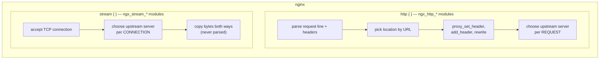

# 🧩 nginx Explained — for people who have never seen nginx

This document explains **every line** of the three nginx files in this lab:

- [`nginx/nginx.conf`](nginx/nginx.conf): the main file
- [`nginx/l7-http.conf`](nginx/l7-http.conf): Layer 7 (HTTP) load balancing
- [`nginx/l4-stream.conf`](nginx/l4-stream.conf): Layer 4 (TCP) load balancing

Read Part 1 first; it gives you the vocabulary for everything else.

**Contents**

- [Part 1 — What nginx is and how its config works](#part-1--what-nginx-is-and-how-its-config-works)
- [Part 2 — `nginx.conf` line by line](#part-2--nginxconf-line-by-line)
- [Part 3 — `l7-http.conf` line by line](#part-3--l7-httpconf-line-by-line)
- [Part 4 — `l4-stream.conf` line by line](#part-4--l4-streamconf-line-by-line)
- [Part 5 — How `location` matching works](#part-5--how-location-matching-works)
- [Part 6 — The `proxy_pass` trailing-slash gotcha](#part-6--the-proxy_pass-trailing-slash-gotcha)
- [Part 7 — Why `http` and `stream` are separate worlds](#part-7--why-http-and-stream-are-separate-worlds)
- [Part 8 — Common mistakes and how to test your config](#part-8--common-mistakes-and-how-to-test-your-config)

---

## Part 1 — What nginx is and how its config works

**nginx** (pronounced "engine-x") is a small, very fast server program. It's used
as:

- a **web server** (serving HTML/CSS/image files from disk),
- a **reverse proxy** (accepting requests and forwarding them to other servers),
- a **load balancer** (a reverse proxy that spreads requests over *several*
  servers). This is how we use it.

It's controlled entirely by **text configuration files**. There's no GUI.

### Directives and blocks

A config file is made of **directives**. There are two kinds:

**1. Simple directives**: a name, some values, and a **semicolon**:

```nginx
worker_processes 1;
listen 8080;
```

> ⚠️ The semicolon is mandatory. Forgetting it is the #1 beginner mistake.

**2. Block directives**: a name, maybe some values, and **curly braces** with
more directives inside (no semicolon after the `}`):

```nginx
events {
    worker_connections 1024;
}
```

A block is also called a **context**. Directives inside a context apply to that
context.

### The contexts used in this lab

```
main                       ← the top level of nginx.conf (outside any braces)
├── events { }             ← low-level connection handling
├── http { }               ← EVERYTHING about HTTP (Layer 7)
│   ├── upstream name { }  ← a named group of backend servers
│   ├── map ... { }        ← a lookup table that creates a variable
│   └── server { }         ← a "virtual server": listen on a port
│       └── location /x/ { }  ← rules for URLs that match /x/
└── stream { }             ← EVERYTHING about raw TCP/UDP (Layer 4)
    ├── upstream name { }
    └── server { }         ← listen on a port (no locations here!)
```

Each directive is only allowed in certain contexts. For example `location` is
only valid inside an `http` `server`, and `listen` only inside a `server`. The
[nginx docs](https://nginx.org/en/docs/dirindex.html) list a "Context:" line for
every directive.

### Inheritance

Many directives set at an outer level (for example `server`) are **inherited** by
the inner levels (`location`) unless the inner level sets its own value. We use
this to set proxy headers once for the whole server. (There's a trap with this;
see [Part 8](#part-8--common-mistakes-and-how-to-test-your-config).)

### `include`

`include path;` pastes another file's contents in at that spot, exactly as if
you had typed it there. We use it to split our config into one file per layer.

### Comments and variables

- Everything after `#` on a line is a **comment**.
- Words starting with `$` are **variables** that nginx fills in for each
  request or connection, e.g. `$remote_addr` (client IP) or `$upstream_addr`
  (backend chosen). Any HTTP request header is available as
  `$http_<name>`: lowercase, with dashes turned into underscores, so
  `X-Version` becomes `$http_x_version`.

---

## Part 2 — `nginx.conf` line by line

```nginx
worker_processes 1;
```

nginx runs one **master** process (reads config, manages the others) and one or
more **worker** processes (handle the actual traffic). Production servers use
`auto` (one worker per CPU core). We use **1** on purpose: each worker keeps its
own round-robin counter and its own list of failed servers. With several
workers, consecutive requests could land on different workers and the
distribution would look less tidy. One worker makes the experiments exactly
repeatable (10/10/10, 18/6/6).

```nginx
error_log /dev/stderr warn;
```

Where nginx writes **its own** problems (config errors, "upstream timed out",
...), and the minimum severity to log (`warn` and worse). `/dev/stderr` sends
them to the container's output, so `docker compose logs nginx` shows them.

```nginx
events {
    worker_connections 1024;
}
```

The `events` block is **required** even if it's almost empty.
`worker_connections` is the maximum number of simultaneous connections per
worker. A proxied request uses **two** connections (client↔nginx and
nginx↔backend), so 1024 allows roughly 500 simultaneous proxied requests.
That's plenty for a classroom.

```nginx
include /etc/nginx/lab/l7-http.conf;
include /etc/nginx/lab/l4-stream.conf;
```

Pull in the two layer files. Paths are **inside the container**:
`docker-compose.yml` mounts `./nginx/l7-http.conf` from your computer to
`/etc/nginx/lab/l7-http.conf` in the container. Each included file contains one
complete top-level block (`http { ... }` or `stream { ... }`), so including them
here, at the main level, is exactly right.

---

## Part 3 — `l7-http.conf` line by line

Everything in this file sits inside one `http { ... }` block. Directives in an
`http` block understand HTTP.

### Logging

```nginx
log_format lab_l7 'L7 $remote_addr "$request" status=$status '
                  'upstream=$upstream_addr upstream_status=$upstream_status '
                  'time=${upstream_response_time}s';
```

Defines a **named log format** called `lab_l7`. The two quoted strings are joined
together. Each `$variable` is filled in per request:

| Variable | Example | Meaning |
|---|---|---|
| `$remote_addr` | `192.168.65.1` | IP of the client that connected to nginx |
| `$request` | `GET /rr/ HTTP/1.1` | the request line |
| `$status` | `200` | status nginx sent to the client |
| `$upstream_addr` | `10.10.10.12:3000, 10.10.10.13:3000` | backend(s) tried. Several = a retry happened |
| `$upstream_status` | `504, 200` | what each backend attempt returned |
| `$upstream_response_time` | `1.006, 0.003` | seconds each backend attempt took |

`${upstream_response_time}s` uses braces so nginx knows where the variable name
ends and the literal `s` begins.

```nginx
access_log /dev/stdout lab_l7;
```

Log every request, using our format, to standard output (visible with
`docker compose logs nginx`).

```nginx
default_type application/json;
```

The `Content-Type` nginx uses for responses it generates itself when it can't
tell the type, such as our `/nginx-health` reply. Responses from the backends
keep their own `Content-Type`.

### Upstreams

An `upstream` block names a **group of backend servers** and (optionally) the
algorithm to choose between them. Later, `proxy_pass http://<name>` sends
requests to that group.

```nginx
upstream backend_rr {
    server app1:3000 max_fails=1 fail_timeout=10s;
    server app2:3000 max_fails=1 fail_timeout=10s;
    server app3:3000 max_fails=1 fail_timeout=10s;
}
```

- `upstream backend_rr { ... }`: a group called `backend_rr`.
- `server app1:3000`: a member. `app1` is a hostname that Docker's internal DNS
  turns into `10.10.10.11`; `3000` is the port the Express app listens on
  **inside** its container. nginx looks up the name **once, at startup** (and on
  reload).
- No algorithm line, so **round robin** (the default).
- `max_fails=1 fail_timeout=10s`: **passive health check**. If 1 attempt to talk
  to this server fails (within a 10 s window), mark it **unavailable for 10 s**.
  After 10 s, nginx sends it one real request to see if it recovered. (These are
  in fact nginx's defaults; we write them out so you can see and change them.
  Setting `max_fails=0` disables the check.) What counts as a "failure" is
  defined by `proxy_next_upstream`, below.

```nginx
upstream backend_weighted {
    server app1:3000 weight=3;
    server app2:3000;
    server app3:3000;
}
```

**Weighted round robin.** `weight=3` gives app1 3 turns per cycle; the others
default to `weight=1`. Out of every 5 requests: app1 gets 3, app2 1, app3 1.
nginx interleaves them smoothly (`app1 app2 app1 app3 app1`) instead of sending
3 in a row.

```nginx
upstream backend_least {
    least_conn;
    server app1:3000;
    ...
}
```

`least_conn;` switches the algorithm: each request goes to the server with the
**fewest active connections** (adjusted by weight). Ties are broken round-robin.

```nginx
upstream backend_iphash {
    ip_hash;
    ...
}
```

`ip_hash;` picks a server from a hash of the **client IP**, so the same client
keeps getting the same server. For IPv4, only the **first 3 octets** are used,
which is why all `10.10.10.x` clients land together (Exercise 4b).

```nginx
upstream backend_userhash {
    hash $http_x_user_id consistent;
    ...
}
```

`hash <key>` hashes **any value you choose**: here, the `X-User-Id` request
header. `consistent` enables **ketama consistent hashing**, so adding or removing
a server only remaps about 1/N of the keys. (Without `consistent`, nginx uses
`hash % N` and almost every key moves when N changes.)

```nginx
upstream api_pool    { server app1:3000; server app2:3000; }
upstream static_pool { server app3:3000; }
upstream stable_pool { server app1:3000; server app2:3000; }
upstream beta_pool   { server app3:3000; }
```

(Shown compressed here.) Plain round-robin groups used by the routing demos. A
single-server upstream like `static_pool` is fine; it just always picks app3.

### The `map`

```nginx
map $http_x_version $version_pool {
    default  stable_pool;
    beta     beta_pool;
}
```

`map <input> <output>` defines a **new variable** (`$version_pool`) computed from
an existing one (`$http_x_version`, the `X-Version` header). Read it like a
lookup table:

| `X-Version` header | `$version_pool` |
|---|---|
| `beta` | `beta_pool` |
| anything else, or missing | `stable_pool` (`default`) |

`map` must be in the `http` context (not inside `server`). It's evaluated lazily,
only when `$version_pool` is actually used.

### The server block

```nginx
server {
    listen 8080;
```

A **virtual server** that accepts connections on port **8080**. (We didn't add
`server_name`, so this server answers for any hostname.)

#### Headers to the backend

```nginx
proxy_set_header Host              $host;
proxy_set_header X-Real-IP         $remote_addr;
proxy_set_header X-Forwarded-For   $proxy_add_x_forwarded_for;
proxy_set_header X-Forwarded-Proto $scheme;
```

`proxy_set_header <Name> <value>` sets a header on the request nginx sends **to
the backend**. They're set at `server` level so every `location` inherits them.

- `Host $host`: by default nginx would send `Host: backend_rr` (the upstream
  name!). `$host` is the hostname the client asked for, **without the port**,
  so the backend sees `localhost`. (Use `$http_host` if you want to keep the
  port.)
- `X-Real-IP $remote_addr`: the IP of the client connected to nginx.
- `X-Forwarded-For $proxy_add_x_forwarded_for`: takes any `X-Forwarded-For` the
  client already sent and **appends** `$remote_addr`, building a chain like
  `client, proxy1, proxy2`. The *first* entry is the original client.
- `X-Forwarded-Proto $scheme`: `http` or `https`, so the app can build correct
  links even when the balancer terminated TLS.

These four lines are what make Exercise 8 work: the L7 port has them, and the
L4 port *can't* have them.

#### Header to the client

```nginx
add_header X-Upstream-Server $upstream_addr always;
```

`add_header` adds a header to the **response** sent back to the client.
`$upstream_addr` is the backend that served it. `always` means "also on error
responses". Without it, `add_header` only applies to 200/201/204/206/301/302/
303/304/307/308.

#### Failover settings

```nginx
proxy_next_upstream error timeout http_502 http_503 http_504;
```

When should nginx give up on a backend and **try the next server** for the same
request?

- `error`: the connection failed or broke,
- `timeout`: connecting or reading took too long,
- `http_502` / `http_503` / `http_504`: the backend answered with one of these
  status codes.

These same conditions count as failures for `max_fails`. Important safety rule:
nginx will **not** retry non-idempotent requests (`POST`, `PATCH`, `LOCK`) on
another server unless you add `non_idempotent`, because sending a payment POST
twice could charge someone twice.

```nginx
proxy_next_upstream_tries 3;
```

Try at most 3 servers for one request (0 = no limit). This prevents a request
bouncing around forever if everything is broken.

```nginx
proxy_connect_timeout 1s;
```

How long to wait for the TCP connection to a backend to open. The default is
60 s. When a container stops, its IP doesn't refuse connections, it simply
**doesn't answer**. Without this short timeout, the first user after a crash
would wait a minute. With it, they wait ~1 s and nginx moves on.

```nginx
proxy_read_timeout 65s;
```

How long to wait for the backend to send the response (between two reads). The
default is 60 s. Our `/slow` endpoint can take up to 60 s, so we allow a bit
more.

#### Locations

```nginx
location / {
    proxy_pass http://backend_rr;
}
```

`location /` matches **every** URL (it's the shortest possible prefix), so it's
the fallback for anything not matched by a more specific location.
`proxy_pass http://backend_rr` forwards the request to the `backend_rr`
upstream. Because `backend_rr` is an upstream name, nginx uses the group rather
than looking up a host called "backend_rr". No trailing slash, so the path
is passed unchanged.

```nginx
location /rr/ {
    proxy_pass http://backend_rr/;
}
```

Matches URLs starting with `/rr/`. Note the **trailing `/`** after the upstream
name. That means "replace the matched part (`/rr/`) with `/`", so
`/rr/slow?ms=10` reaches the backend as `/slow?ms=10`. See
[Part 6](#part-6--the-proxy_pass-trailing-slash-gotcha).

```nginx
location /weighted/ { proxy_pass http://backend_weighted/; }
location /least/    { proxy_pass http://backend_least/; }
location /iphash/   { proxy_pass http://backend_iphash/; }
location /userhash/ { proxy_pass http://backend_userhash/; }
```

Same pattern: one URL prefix per algorithm, so you can compare algorithms
**without editing the config**. Each strips its prefix.

```nginx
location /api/ {
    proxy_pass http://api_pool;
}
location /static/ {
    proxy_pass http://static_pool;
}
```

**Path-based routing.** URLs under `/api/` go to app1+app2; URLs under
`/static/` go to app3. **No trailing slash**, so the backend receives the full
original path (`/api/info`), which is what our Express routes expect.

```nginx
location /version/ {
    rewrite ^/version/(.*)$ /$1 break;
    proxy_pass http://$version_pool;
}
```

**Header-based routing.**

- `proxy_pass http://$version_pool;`: the target is a **variable**. nginx
  evaluates it per request (`stable_pool` or `beta_pool`, from the `map`) and,
  since that matches an upstream name, uses that group.
- When `proxy_pass` contains a variable, nginx doesn't do the automatic
  prefix replacement. So we strip `/version` ourselves:
  `rewrite <regex> <replacement> break;`. `^/version/(.*)$` captures everything
  after `/version/` into `$1`, and the URI becomes `/$1`. So `/version/` becomes
  `/` and `/version/slow?ms=10` becomes `/slow?ms=10` (the query string is kept
  automatically). `break` means "stop processing rewrites and use this URI here".

```nginx
location = /nginx-health {
    return 200 '{"status":"ok","from":"nginx (layer 7)"}\n';
}
```

`=` means **exact match**: only `/nginx-health`, not `/nginx-health/x`. `return`
makes nginx answer **by itself**: no backend involved. It's handy for checking
nginx is up independently of the apps.

---

## Part 4 — `l4-stream.conf` line by line

Everything here sits inside `stream { ... }`. In this context nginx deals with
**TCP connections**, not HTTP requests. Many directive names are the same as in
`http` (`upstream`, `server`, `proxy_pass`, `access_log`), but they are a
**different module with different rules**.

```nginx
log_format lab_l4 'L4 $remote_addr -> :$server_port upstream=$upstream_addr '
                  'status=$status bytes_in=$bytes_received bytes_out=$bytes_sent '
                  'session=${session_time}s';
access_log /dev/stdout lab_l4;
```

Stream logs are written **once per connection, when it closes**. Variables:

| Variable | Meaning |
|---|---|
| `$remote_addr` | client IP |
| `$server_port` | which of our ports it connected to (9090, 9000, ...) |
| `$upstream_addr` | backend chosen for this connection |
| `$status` | session status: `200` = OK, `502` = couldn't connect to a backend, `400`/`403`/`500`/`503` for other problems. These reuse HTTP-like numbers but are **not** HTTP statuses. |
| `$bytes_received` / `$bytes_sent` | bytes from / to the client |
| `$session_time` | how long the connection lasted |

Notice what **doesn't exist** here: `$request`, `$uri`, `$http_*`. The stream
module never parses the bytes, so it has no idea what a URL or header is.

```nginx
upstream l4_http_rr {
    server app1:3000 max_fails=1 fail_timeout=10s;
    ...
}
```

Same syntax as in `http`, but note: these are **the same Express apps**. A
"failure" here can only mean **the TCP connection failed**. An HTTP 500 from
Express looks like perfectly normal bytes to the stream module.

```nginx
upstream l4_http_least { least_conn; ... }
```

Least connections, counting **TCP connections**.

```nginx
upstream l4_http_hash { hash $remote_addr consistent; ... }
```

Consistent hash on the client IP. (`ip_hash` doesn't exist in `stream`; `hash`
with `$remote_addr` uses the **full** address, unlike `ip_hash`.) You could also
hash `$remote_addr$remote_port`, but that's unique per connection and would
behave almost randomly.

```nginx
upstream l4_echo {
    server tcp-echo-1:7000;
    server tcp-echo-2:7000;
    server tcp-echo-3:7000;
}
```

The non-HTTP echo servers on port 7000.

```nginx
proxy_connect_timeout 1s;
proxy_next_upstream on;
proxy_timeout 65s;
```

Placed in `stream` (outside any `server`), so all servers below inherit them.

- `proxy_connect_timeout 1s`: same idea as in http: give up on a dead backend
  fast.
- `proxy_next_upstream on`: if the connection to a backend can't be
  established, try the next one. (`on` is already the default. Note there are no
  `http_502` options here, since there's no HTTP.) Once the connection is
  established and bytes have flowed, nginx can no longer switch servers.
- `proxy_timeout 65s`: close the connection if **neither side sends anything**
  for 65 s.

```nginx
server {
    listen 9090;
    proxy_pass l4_http_rr;
}
```

Listen for TCP on 9090 and pipe every connection to `l4_http_rr`. Compare with
http:

- `proxy_pass l4_http_rr;`: **no `http://`**, because this isn't an HTTP proxy.
- **No `location` blocks.** You can't have them: there's no URL at this layer.
- **No `proxy_set_header`.** It doesn't exist in stream.

```nginx
server { listen 9091; proxy_pass l4_http_least; }
server { listen 9092; proxy_pass l4_http_hash; }
server { listen 9000; proxy_pass l4_echo; }
```

One port per algorithm (a stream server can only `proxy_pass` to one upstream,
and an upstream has one algorithm), plus the echo service on 9000.

---

## Part 5 — How `location` matching works

When a request arrives at an `http` `server`, nginx picks **one** `location`
using these rules:

| Syntax | Type | Example | Matches |
|---|---|---|---|
| `location = /path` | **exact** | `= /nginx-health` | only exactly `/nginx-health` |
| `location ^~ /path` | prefix, and stop (skip regexes) | `^~ /images/` | anything starting with `/images/` |
| `location ~ regex` | **regex**, case-sensitive | `~ \.php$` | `/a.php` |
| `location ~* regex` | regex, case-insensitive | `~* \.(jpg\|png)$` | `/A.JPG` |
| `location /path` | **prefix** | `/api/` | `/api/`, `/api/info`, `/api/x/y` |

The algorithm, simplified:

1. If an **exact** (`=`) match exists, use it immediately.
2. Otherwise find the **longest matching prefix**. Remember it.
3. If that prefix was marked `^~`, use it.
4. Otherwise test **regex** locations **in the order they appear in the file**;
   the first one that matches wins.
5. If no regex matched, use the longest prefix from step 2.

For our config (no regexes), it's simply **the longest matching prefix wins**:

| Request | Candidates | Winner |
|---|---|---|
| `/nginx-health` | `= /nginx-health`, `/` | `= /nginx-health` (exact) |
| `/rr/` | `/rr/`, `/` | `/rr/` (longer) |
| `/api/info` | `/api/`, `/` | `/api/` |
| `/health` | `/` | `/` → `backend_rr` → backend receives `/health` |
| `/rr` (no slash!) | `/` only, since `/rr/` doesn't match `/rr` | `/` → backend receives `/rr` → 404 |

The last row is a classic surprise: `location /rr/` does **not** match `/rr`.

---

## Part 6 — The `proxy_pass` trailing-slash gotcha

Whether `proxy_pass` has a **URI part** (anything after the host, even a single
`/`) changes what path the backend receives:

| Config | Request | Backend receives |
|---|---|---|
| `location /rr/ { proxy_pass http://backend_rr/; }` | `/rr/slow?ms=10` | `/slow?ms=10` ← prefix **replaced** by `/` |
| `location /rr/ { proxy_pass http://backend_rr; }` | `/rr/slow?ms=10` | `/rr/slow?ms=10` ← passed **unchanged** |
| `location /api/ { proxy_pass http://api_pool; }` | `/api/info` | `/api/info` ← unchanged (what we want here) |
| `location /api/ { proxy_pass http://api_pool/v2/; }` | `/api/info` | `/v2/info` ← `/api/` replaced by `/v2/` |

**Rule:** if `proxy_pass` has a URI part, the part of the request that matched
the `location` is **replaced** by that URI. If it has no URI part, the request
URI is passed **as is**.

In this lab:
- `/rr/`, `/weighted/`, ... **strip** their prefix, because our backend has no
  `/rr/` route.
- `/api/` and `/static/` **keep** it, because the backend *does* have
  `/api/info` and `/static/info`.

**See it yourself.** Our backend returns `pathReceived` in every response,
including 404s. Asking app1 directly for what it *would* get without the slash:

```bash
curl -s localhost:3001/rr/ | grep -E 'tag|pathReceived'
```

```
  "tag": "no route matched (404)",
    "pathReceived": "/rr/",
```

while through nginx (with the slash):

```bash
curl -s "localhost:8080/rr/slow?ms=10" | grep pathReceived
```

```
    "pathReceived": "/slow?ms=10",
```

Also watch out for mismatched slashes like `location /rr` with
`proxy_pass http://backend_rr/;`. Then `/rr/x` becomes `//x` and `/rrfoo` becomes
`/foo`. Keep both sides ending in `/`, or neither.

When `proxy_pass` contains **variables** (like our `/version/` location), the
replacement rule does not apply. That's why we used `rewrite` there.

---

## Part 7 — Why `http` and `stream` are separate worlds



- They are implemented by **separate sets of modules**. `upstream` in `http` is
  `ngx_http_upstream_module`; `upstream` in `stream` is
  `ngx_stream_upstream_module`. Same name, different code, different directives.
- **Upstreams can't be shared.** An upstream defined in `http` doesn't exist in
  `stream`. That's why `l4-stream.conf` defines its own (`l4_http_rr`, ...)
  even though they point at the same apps.
- **Variables differ.** `$request`, `$uri`, `$http_*` exist only in `http`.
  `$bytes_received` and `$session_time` are typical `stream` variables.
- **Ports can't be shared.** A port is either an `http` listener or a `stream`
  listener. That's why L7 uses 8080 and L4 uses 9090/9091/9092/9000.
- The stream module must be compiled in. Official nginx Docker images include
  it (`nginx -V` shows `--with-stream`). Some distro packages ship it as a
  loadable module (`load_module modules/ngx_stream_module.so;`).
- Both blocks live at the **main** level; you can't put `stream` inside `http`
  or vice versa.

---

## Part 8 — Common mistakes and how to test your config

### Always test before reloading

```bash
docker compose exec nginx nginx -t
```

```
nginx: the configuration file /etc/nginx/nginx.conf syntax is ok
nginx: configuration file /etc/nginx/nginx.conf test is successful
```

If there's a problem, it tells you the **file and line**. For example, a forgotten `;` before a `}`:

```
nginx: [emerg] unexpected "}" in /etc/nginx/lab/l7-http.conf:120
nginx: configuration file /etc/nginx/nginx.conf test failed
```

Then apply without dropping existing connections:

```bash
docker compose exec nginx nginx -s reload
```

If the new config is broken, a reload is **refused** and nginx keeps running the
old config. That makes `-s reload` safe. Restarting the container with a broken
config, on the other hand, means nginx won't start at all.

To see the full config nginx actually loaded (with includes expanded):

```bash
docker compose exec nginx nginx -T
```

### The usual suspects

| Mistake | Symptom | Fix |
|---|---|---|
| Missing `;` | `unexpected "}"` or `directive "x" is not terminated by ";"` | Add the semicolon on the line **before** the one reported |
| Directive in the wrong context | `"location" directive is not allowed here` | Check the "Context:" in the nginx docs; e.g. `location` in `stream`, or `map` inside `server` |
| `proxy_set_header` in a location | Headers like X-Forwarded-For suddenly **disappear** for that location | Defining **any** `proxy_set_header` in a block discards **all** inherited ones. Repeat them all, or keep them at server level (as we do) |
| Same issue with `add_header` | `X-Upstream-Server` missing for one location | Same inheritance rule |
| Trailing-slash mismatch in `proxy_pass` | Backend returns 404; `pathReceived` is wrong | See [Part 6](#part-6--the-proxy_pass-trailing-slash-gotcha) |
| `location /rr/` but you requested `/rr` | Goes to `location /` instead | Request `/rr/`, or add `location = /rr { return 301 /rr/; }` |
| Backend host doesn't resolve | `host not found in upstream "app2:3000"` | The container is stopped or misnamed. `docker compose start app2` |
| `http://` in a stream `proxy_pass` | `invalid host in upstream "http://u"` | Stream uses `proxy_pass upstream_name;`, no scheme |
| Two server blocks on the same port | Requests go to the "wrong" one | The first one listed is the **default server** for unknown hostnames; use `server_name` and/or `listen 8080 default_server;` |
| Expecting active health checks | `health_check` → `unknown directive` | That's nginx Plus only. Open-source nginx does passive checks (`max_fails`/`fail_timeout`) |
| Expecting `sticky cookie` | `unknown directive "sticky"` | nginx Plus only. Use `ip_hash` or `hash $cookie_<name> consistent;` |
| Using `localhost` / `127.0.0.1` for a backend inside Docker | `connection refused` | Inside a container, localhost is **that container**. Use the service name (`app1`) |
| Editing a file but nothing changes | Old behaviour | You didn't reload. `nginx -s reload` |
