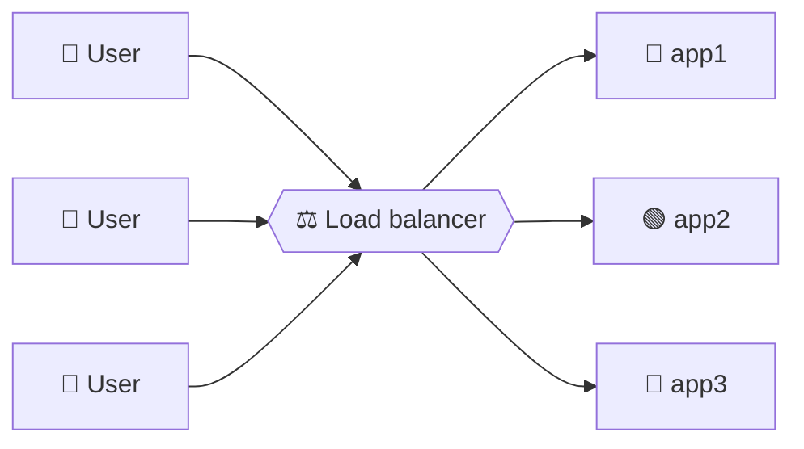
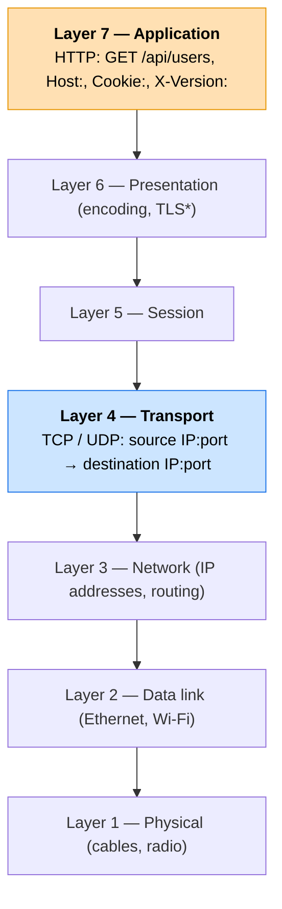
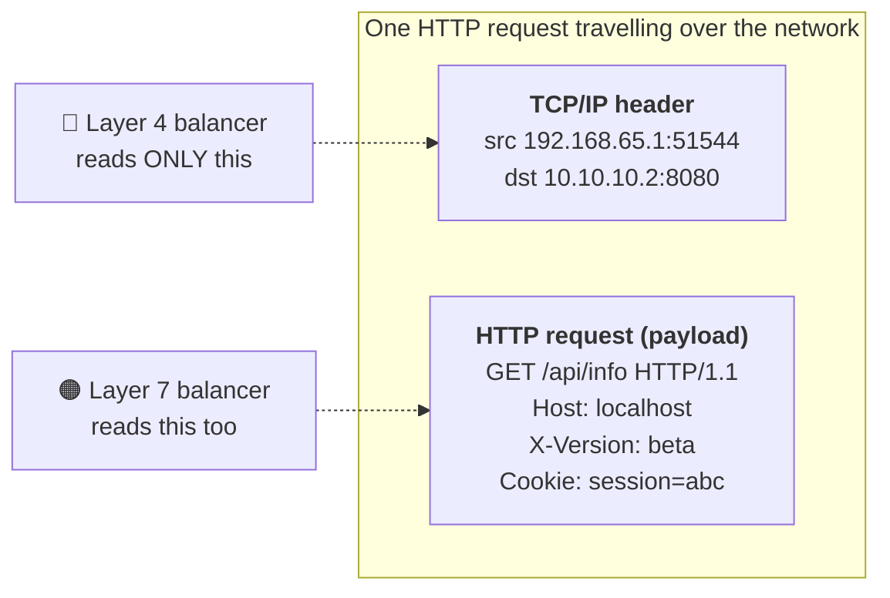
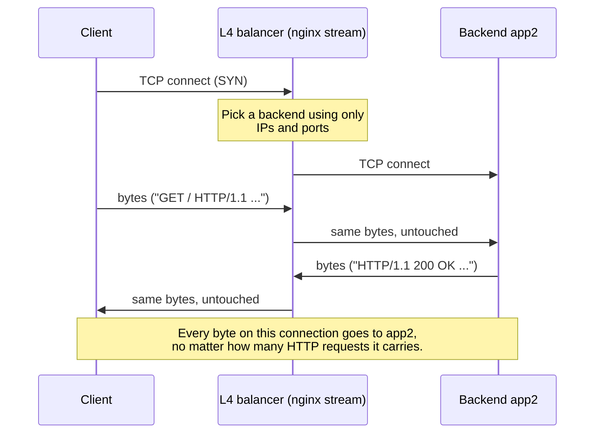
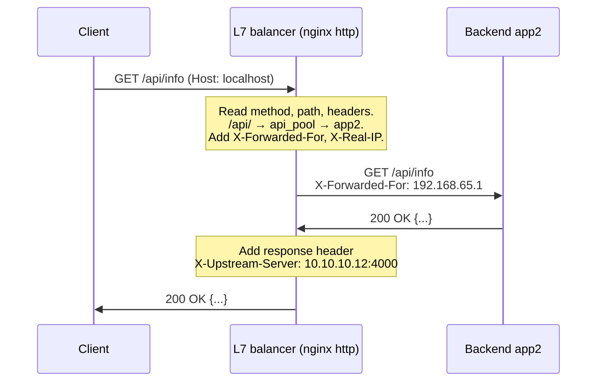
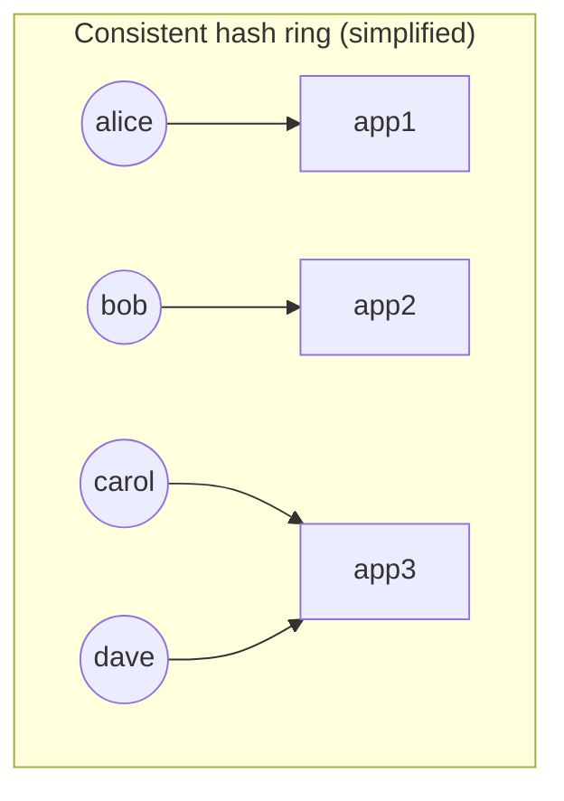
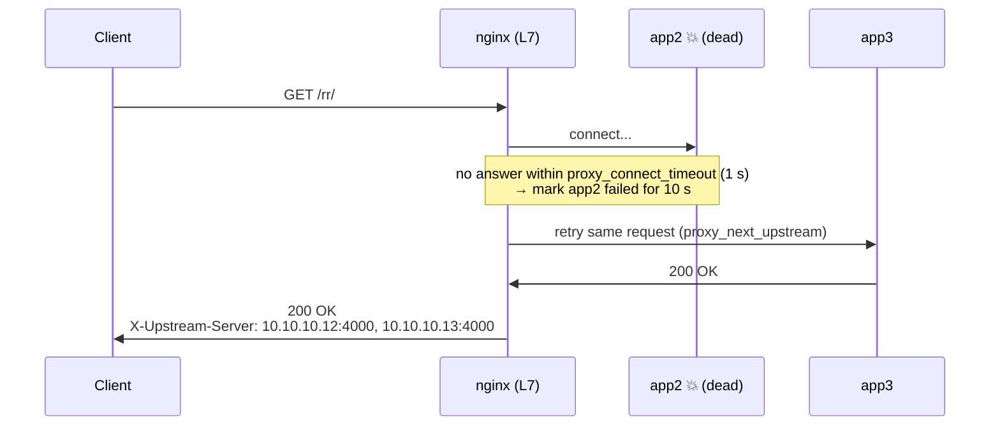
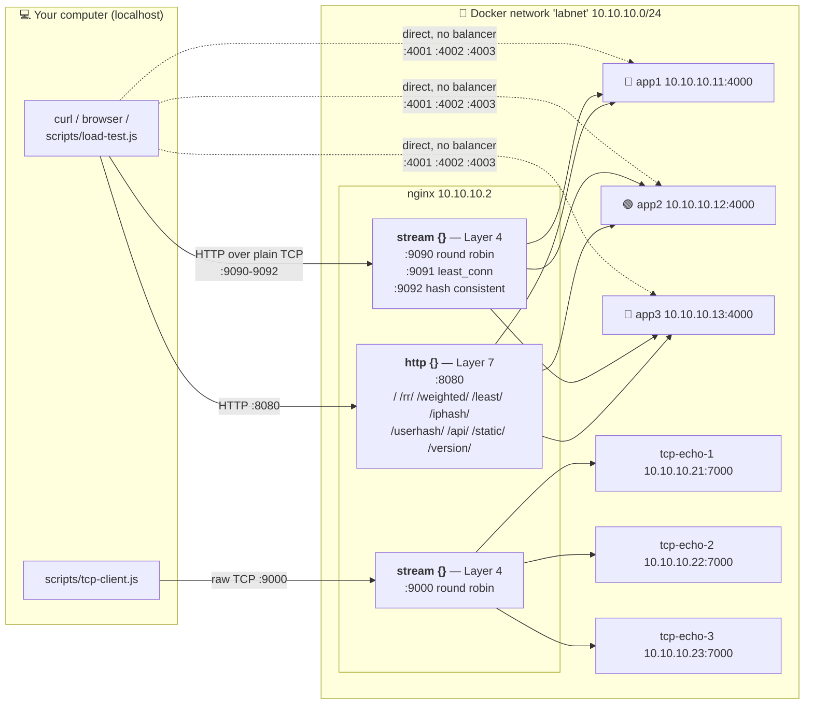

# ⚖️ Load Balancing Lab — Layer 4 vs Layer 7

A small, runnable lab that shows **how load balancers work** and, above all, the
difference between **Layer 4 (TCP)** and **Layer 7 (HTTP)** load balancing.

You'll run three copies of a tiny Express app, three tiny TCP servers, and
**nginx** in front of them, then do experiments where you can *see* every
concept happen in your terminal.

> 📚 Companion docs
> - [`EXERCISES.md`](EXERCISES.md): 10 guided experiments with expected output. **Start here after the Quick start.**
> - [`NGINX_EXPLAINED.md`](NGINX_EXPLAINED.md): a line-by-line walkthrough of every nginx config file, for people who have never seen nginx.

---

## Table of contents

1. [What is load balancing and why do we need it?](#1-what-is-load-balancing-and-why-do-we-need-it)
2. [The OSI model in brief: Layer 4 vs Layer 7](#2-the-osi-model-in-brief-layer-4-vs-layer-7)
3. [Layer 4 load balancing](#3-layer-4-load-balancing)
4. [Layer 7 load balancing](#4-layer-7-load-balancing)
5. [Comparison table: L4 vs L7](#5-comparison-table-l4-vs-l7)
6. [Load-balancing algorithms](#6-load-balancing-algorithms)
7. [Health checks, failover and sticky sessions](#7-health-checks-failover-and-sticky-sessions)
8. [Real-world mapping](#8-real-world-mapping)
9. [Architecture of this project](#9-architecture-of-this-project)
10. [Prerequisites and Quick start](#10-prerequisites-and-quick-start)
11. [Port and endpoint reference](#11-port-and-endpoint-reference)
12. [Troubleshooting](#12-troubleshooting)
13. [Glossary](#13-glossary)

---

## 1. What is load balancing and why do we need it?

### The supermarket analogy 🛒

Imagine a supermarket with **one** checkout lane. On a quiet Tuesday morning it's
fine. On Saturday afternoon the queue reaches the back of the shop, customers
leave, and if that one cashier goes on a break, **nobody** can pay.

So the shop opens **several lanes** and puts a **person at the front** who
points each customer to a lane: *"You, lane 3 please."*

| Supermarket | Web systems |
|---|---|
| Customers | Requests from users |
| Checkout lanes | Servers (identical copies of your app) |
| The person pointing to lanes | **The load balancer** |
| "Go to the next lane in turn" | Round robin |
| "Go to the lane with the shortest queue" | Least connections |
| "You always go to lane 2, you're a regular" | Sticky sessions / IP hash |
| A lane closes, customers are sent elsewhere | Failover |

### Why do we need it?

- **Scalability.** One server can only handle so many requests per second. When
  traffic grows, add more servers behind the balancer ("scale out") instead of
  buying an ever-bigger machine ("scale up").
- **Availability.** If one server crashes, the balancer stops sending it traffic
  and users don't notice. No single server is a single point of failure.
- **Zero-downtime deploys.** To release a new version, take servers out of the
  pool one at a time, update them, and put them back. The site stays up the
  whole time. (Variations of this are called *rolling*, *blue/green* and
  *canary* deployments.)
- **Flexibility.** A smart (Layer 7) balancer can send `/api` to one group of
  servers and `/images` to another, or send beta testers to a new version.



---

## 2. The OSI model in brief: Layer 4 vs Layer 7

Networking is described in **layers**. Each layer relies on the one below it and
adds something. The full OSI model has 7 layers, but for load balancing only two
matter:



<sub>*In practice people usually lump TLS in with "Layer 7".</sub>

**Envelope analogy ✉️:** an HTTP request is a letter inside an envelope.

- **Layer 4** reads only the **envelope**: from-address, to-address, which door
  (port). It forwards the envelope without opening it.
- **Layer 7** **opens the envelope and reads the letter**: which page you want
  (`/api/info`), who you are (cookies), what language you prefer (headers), and
  can even **write a note on it** (`X-Forwarded-For: <your IP>`) before passing
  it on.

What each layer "sees" in the same HTTP request:



---

## 3. Layer 4 load balancing

A Layer 4 balancer works with **TCP connections** (or UDP datagrams). When a
client connects, the balancer picks a backend, connects to it, and then just
**copies bytes in both directions** until the connection closes.



**What it can see:** source IP and port, destination IP and port, the protocol
(TCP/UDP), and how many connections it currently has open to each backend
(it knows because it opened them itself: every client connection is paired with
a second connection that the load balancer makes to the backend).

**What it can't see:** URL paths, HTTP methods, headers, cookies, hostnames
(except the TLS SNI, via a special trick), request boundaries. It cannot tell
one HTTP request from the next on the same connection.

**Pros**
- ⚡ **Fast and cheap.** No parsing, so very little CPU per connection. It can
  handle millions of connections.
- 🔌 **Protocol-agnostic.** Works for HTTP, databases (PostgreSQL, MySQL),
  Redis, MQTT, game servers, SMTP, your own made-up protocol... anything on TCP/UDP.
- 🔒 **Can pass TLS straight through.** Encrypted traffic is forwarded as is, and
  the backend does the decryption ("end-to-end encryption").

**Cons**
- 🙈 **No smart routing.** It can't send `/api` somewhere different from `/images`.
- 🏷️ **Can't add headers,** so backends lose the client's real IP (they see the
  balancer's IP). The workaround is the **PROXY protocol**, which both sides must
  support.
- 🧱 **Balances connections, not requests.** One long-lived keep-alive or
  WebSocket connection sticks to one backend forever, which can make load uneven.
- 🤷 **Health checks are basic:** "does the TCP port accept connections?", not
  "does the app return 200?".

---

## 4. Layer 7 load balancing

A Layer 7 balancer is a full **HTTP proxy**. It terminates the client's HTTP
connection, **reads the whole request**, decides where it should go, and sends
a *new* request to the chosen backend.



**What it can see:** everything in HTTP: method (`GET`/`POST`), URL path and
query string, `Host`, every header, cookies, and even the body if configured.

**Pros**
- 🧭 **Smart routing:** by path (`/api/` → API servers), host
  (`shop.example.com` vs `blog.example.com`), header (`X-Version: beta`),
  cookie, or method.
- 🏷️ **Header injection:** adds `X-Forwarded-For`, `X-Real-IP` and
  `X-Forwarded-Proto` so backends know the real client. It can also add
  response headers.
- 🔐 **TLS termination:** it decrypts HTTPS once, so backends can speak plain HTTP
  and certificates live in one place.
- ♻️ **Per-request balancing and retries:** each request is balanced on its own,
  even on one keep-alive connection, and a failed request can be **retried on
  another server**.
- 🧰 Extras: caching, compression, rate limiting, auth, rewriting URLs, a WAF.

**Cons**
- 🔥 **More CPU and memory.** It must parse (and often decrypt) every request.
- 🌐 **HTTP only** (or the specific protocols it understands, like gRPC).
- 🔑 **It sees everything.** To route HTTPS by URL it must decrypt it, so the
  balancer holds your certificates and becomes a security-sensitive component.
- ⏱️ Slightly **more latency** (two separate HTTP connections, plus parsing).

---

## 5. Comparison table: L4 vs L7

| | **Layer 4 (Transport)** | **Layer 7 (Application)** |
|---|---|---|
| Works with | TCP / UDP connections | HTTP(S) requests (also gRPC, WebSocket upgrade) |
| Decides using | IP addresses, ports | URL, host, headers, cookies, method + everything L4 has |
| Unit of balancing | **Connection** | **Request** |
| Reads the payload? | ❌ No, just copies bytes | ✅ Yes, parses HTTP |
| Can add `X-Forwarded-For`? | ❌ No (PROXY protocol instead) | ✅ Yes |
| Path / header routing | ❌ | ✅ |
| Non-HTTP protocols | ✅ Any TCP/UDP | ❌ |
| TLS | Pass-through (backend decrypts) | Usually terminates (balancer decrypts) |
| Retry a failed request elsewhere | Only if the *connect* fails | ✅ Retry on errors, timeouts, 502/503/504 |
| Health check depth | "Port open?" | "Does `/health` return 200?" |
| Speed / cost | Faster, cheaper | More CPU, a bit more latency |
| In this lab | nginx `stream {}` on ports **9090–9092, 9000** | nginx `http {}` on port **8080** |
| Cloud example | AWS **NLB**, GCP TCP/UDP LB | AWS **ALB**, GCP HTTP(S) LB |

**Rule of thumb:** use **L7** for websites and HTTP APIs when you want smart
routing. Use **L4** for non-HTTP protocols, for extreme throughput, or when
traffic must stay encrypted all the way to the backend.

---

## 6. Load-balancing algorithms

| Algorithm | How it picks | Good for | Watch out for | Try it |
|---|---|---|---|---|
| **Round robin** | In turn: 1, 2, 3, 1, 2, 3… | Identical servers, similar requests | Ignores how busy each server is | `/rr/`, `:9090` |
| **Weighted round robin** | In turn, but bigger weight = more turns (3:1:1) | Servers of different sizes; slowly shifting traffic to a new version | Weights are static; you set them by hand | `/weighted/` |
| **Least connections** | Server with the fewest *active* connections | Requests with very different durations (uploads, reports, slow queries) | Needs accurate connection counts | `/least/`, `:9091` |
| **IP hash** | `hash(client IP) → server` | Simple stickiness without cookies | Many users behind one office NAT all land on one server; nginx's `ip_hash` only uses the first 3 octets | `/iphash/` |
| **Consistent hashing** | Servers and keys placed on a "ring"; a key goes to the next server clockwise | Caches and stickiness when servers come and go | Can be uneven with few servers | `/userhash/`, `:9092` |
| *Random / power of two choices* | Pick 2 random servers, use the less busy one | Very large fleets | (not shown in this lab) | — |

**Why "consistent" hashing?** With plain `hash(key) % N`, changing N from 3 to 4
moves about **75%** of keys to a different server, so every cache goes cold at
once. Consistent hashing moves only about **1/N** of keys (25% here), because
each server owns slices of a ring and adding a server only takes over its
neighbours' slices.



---

## 7. Health checks, failover and sticky sessions

### Health checks

The balancer must know which servers are alive.

- **Passive health checks** (what open-source nginx does): watch **real traffic**.
  If a request to app2 fails `max_fails` times within `fail_timeout`, mark app2 as
  down for `fail_timeout` seconds, then quietly try it again with a real request.
  The downside is that a real user request has to fail first, but with
  `proxy_next_upstream` nginx immediately **retries that same request on another
  server**, so the user still gets a 200 (just a bit slower).
- **Active health checks:** the balancer **polls** each server (for example
  `GET /health` every 5 s) and removes failing ones *before* users hit them. This
  is in nginx Plus, HAProxy, Envoy, AWS ALB/NLB, Kubernetes readiness probes,
  and others. Our backends expose `/health` so you can see what such an endpoint
  looks like.

### Failover



### Sticky sessions, and why stateless apps matter

Suppose app1 keeps your shopping cart **in its own memory**. Your next request
goes to app2, which has never heard of your cart, so the cart looks empty. 😱
(You can see this "separate memory" in the lab: each server's `requestCount`
only counts its own requests.)

Two fixes:

1. **Sticky sessions:** make the balancer always send you to the same server
   (IP hash, or a cookie). This works, but load becomes uneven, and **if that
   server dies your session is lost anyway**.
2. **Stateless servers (better):** keep session data **outside** the app servers
   (Redis, a database, or a signed cookie/JWT). Then *any* server can handle
   *any* request, so you can add, remove or restart servers freely. This is why
   "make your app stateless" is the first rule of horizontal scaling.

---

## 8. Real-world mapping

| Product | Layer | Notes |
|---|---|---|
| **nginx** `stream {}` | L4 | What this lab uses on ports 9090–9092, 9000 |
| **nginx** `http {}` | L7 | What this lab uses on port 8080 |
| **AWS Network Load Balancer (NLB)** | L4 | TCP/UDP/TLS, millions of req/s, static IPs, can preserve client IP |
| **AWS Application Load Balancer (ALB)** | L7 | HTTP/HTTPS routing by path, host, header; active health checks; TLS termination |
| **AWS Gateway Load Balancer** | L3 | For inserting firewalls/appliances, a niche case |
| **Google Cloud** | both | "Network LB" (L4) vs "Application LB" (L7) |
| **HAProxy** | L4 *and* L7 | `mode tcp` vs `mode http`, the same idea as nginx stream vs http |
| **Envoy** | L4 *and* L7 | Used inside service meshes (Istio); great observability |
| **Kubernetes `Service`** (ClusterIP / NodePort / LoadBalancer) | L4 | kube-proxy balances TCP/UDP connections across Pods |
| **Kubernetes `Ingress` / Gateway API** | L7 | Usually nginx, Traefik, Envoy or a cloud ALB routing by host/path |
| **DNS round robin** | "L3-ish" | Several IPs for one name; crude, no health checks, caching delays failover |

A common production setup **stacks both**: a cloud **L4** balancer (NLB) in front
of a fleet of **L7** proxies (nginx/Envoy/Ingress), which route to app servers.

---

## 9. Architecture of this project



The **same three Express apps** sit behind **both** the L7 port and the L4
ports. That's deliberate: the backends don't change, only the balancer's layer
changes, so any difference you observe is caused by the layer.

Files:

```
.
├── README.md              ← you are here (theory + how to use)
├── NGINX_EXPLAINED.md     ← line-by-line nginx walkthrough
├── EXERCISES.md           ← guided experiments
├── docker-compose.yml     ← starts everything
├── backend/               ← the Express app (run 3×)
│   ├── server.js
│   ├── package.json
│   └── Dockerfile
├── tcp-echo/
│   └── server.js          ← raw TCP echo server, Node "net" module (run 3×)
├── nginx/
│   ├── nginx.conf         ← main file, includes the two below
│   ├── l7-http.conf       ← http {}   = Layer 7
│   └── l4-stream.conf     ← stream {} = Layer 4
└── scripts/
    ├── load-test.js       ← send N requests, show distribution chart
    └── tcp-client.js      ← talk raw TCP to the L4 echo port
```

---

## 10. Prerequisites and Quick start

### Prerequisites

- **Docker Desktop** (macOS/Windows) or Docker Engine + Compose plugin (Linux).
  Check with `docker compose version`.
- **Node.js 20+** on your computer, to run the scripts in `scripts/`. Check with
  `node -v`. (The servers run inside Docker; you don't need Node for them.)
- `curl` (already installed on macOS, Linux and Windows 10+).
- Free ports: 8080, 9090, 9091, 9092, 9000, 4001–4003, 7001–7003.

### Quick start

```bash
# 1. Start everything (first run downloads images and builds; takes ~1 minute)
docker compose up --build

# 2. In a SECOND terminal, check that nginx answers
curl http://localhost:8080/

# 3. Send 30 requests and see how they were spread across servers
node scripts/load-test.js http://localhost:8080/rr/ 30

# 4. Talk to the non-HTTP echo servers through the Layer 4 balancer
node scripts/tcp-client.js
```

Prefer to run in the background? Use `docker compose up --build -d`, then
`docker compose logs -f` to watch the logs.

**Stop everything:** `Ctrl+C` in the first terminal, then
`docker compose down`.

Now open **[EXERCISES.md](EXERCISES.md)** and work through the experiments.

### Running the Node servers WITHOUT Docker (optional)

Useful if you just want to poke at the Express app or the echo server:

```bash
# Express app (needs one npm install)
cd backend
npm install
SERVER_NAME=app1 PORT=4001 node server.js      # or: npm run app1
# in other terminals:  npm run app2   /   npm run app3

# TCP echo server (no install needed)
SERVER_NAME=tcp-echo-1 PORT=7001 node tcp-echo/server.js
node scripts/tcp-client.js 7001 3
```

> Windows PowerShell: `$env:SERVER_NAME="app1"; $env:PORT="4001"; node server.js`

> Stop the Docker lab first (`docker compose down`), or use other port numbers,
> because Docker already publishes 4001–4003 and 7001–7003.

To put a **locally installed nginx** in front of them, change the upstream
addresses in `nginx/*.conf` from `app1:4000` to `127.0.0.1:4001` (and so on),
fix the two `include` paths in `nginx.conf`, and start nginx with
`nginx -c /full/path/to/nginx/nginx.conf`. The Docker setup avoids all of
this, which is why it's the recommended way.

---

## 11. Port and endpoint reference

### Ports on your computer

| Port | Layer | Goes to | Algorithm | Notes |
|---|---|---|---|---|
| **8080** | **L7** (http) | app1–3 | depends on path (below) | Adds X-Forwarded-For etc.; response header `X-Upstream-Server` |
| **9090** | **L4** (stream) | app1–3 :4000 | round robin | HTTP works, but no added headers, no path routing |
| **9091** | **L4** (stream) | app1–3 :4000 | least_conn | |
| **9092** | **L4** (stream) | app1–3 :4000 | hash $remote_addr consistent | |
| **9000** | **L4** (stream) | tcp-echo-1–3 :7000 | round robin | Non-HTTP protocol |
| 4001 / 4002 / 4003 | — | app1 / app2 / app3 directly | — | Bypasses nginx (baseline, and for `/crash`) |
| 7001 / 7002 / 7003 | — | tcp-echo-1 / 2 / 3 directly | — | Bypasses nginx |

### URL prefixes on the L7 port (8080)

| URL | Upstream | Servers | Algorithm | Backend receives |
|---|---|---|---|---|
| `/` (anything not matched below) | `backend_rr` | app1, app2, app3 | round robin + passive health checks | same path |
| `/rr/…` | `backend_rr` | app1, app2, app3 | round robin + passive health checks | `/…` (prefix stripped) |
| `/weighted/…` | `backend_weighted` | app1 ×3, app2, app3 | weighted round robin | `/…` |
| `/least/…` | `backend_least` | app1, app2, app3 | least_conn | `/…` |
| `/iphash/…` | `backend_iphash` | app1, app2, app3 | ip_hash | `/…` |
| `/userhash/…` | `backend_userhash` | app1, app2, app3 | hash on `X-User-Id` header, consistent | `/…` |
| `/api/…` | `api_pool` | app1, app2 | round robin | `/api/…` (unchanged) |
| `/static/…` | `static_pool` | app3 | — | `/static/…` (unchanged) |
| `/version/…` | `stable_pool` or `beta_pool` | app1+app2, or app3 if `X-Version: beta` | round robin | `/…` |
| `/nginx-health` | — | answered by nginx itself | — | — |

> Note: `/` and `/rr/` share the **same** upstream, so they share one
> round-robin position.

### Backend endpoints (every app)

| Method + path | What it does |
|---|---|
| `GET /` | JSON: server name/colour, hostname, port, PID, `requestCount`, `inFlight`, `pathReceived`, `tcpPeer`, important headers, all headers |
| `GET /api/info` | Same, tagged `"API pool"` |
| `GET /static/info` | Same, tagged `"Static pool"` |
| `GET /slow?ms=3000` | Waits 3000 ms, then responds (max 60000) |
| `GET /slow?ms=3000&only=app1` | **Only app1** waits; the others answer immediately (simulates one overloaded server) |
| `GET /health` | `200 {"status":"ok"}` |
| `POST /crash` | Process exits; the container stays down (no auto-restart) |
| anything else | `404` with the same JSON, so you can see `pathReceived` |

Every response also carries an `X-Served-By: appN` header.

---

## 12. Troubleshooting

| Problem | Fix |
|---|---|
| `Bind for 0.0.0.0:8080 failed: port is already allocated` | Something else uses the port. Find it with `lsof -i :8080` (macOS/Linux) or `netstat -ano \| findstr :8080` (Windows) and stop it, or change the **left** number in `docker-compose.yml` (`"8081:8080"`). |
| `Cannot connect to the Docker daemon` | Docker isn't running. Start Docker Desktop and wait for it to say "running". |
| `Pool overlaps with other one on this host` | Another Docker network already uses `10.10.10.0/24`. Change the subnet **and** all `ipv4_address` values in `docker-compose.yml` (for example to `10.20.30.x`). |
| `curl: (52) Empty reply` / `connection refused` right after start | Wait a few seconds, then check `docker compose ps`; all 7 containers should be "Up". |
| A server shows `Exited (1)` | You (or a student 😉) crashed it. `docker compose start app1` |
| **`host not found in upstream "app2:4000"`** when reloading nginx | A backend container is **stopped**, so its name doesn't resolve and nginx refuses the new config (it keeps running the old one). Start the backend, then reload. |
| Edited an nginx file, nothing changed | Reload: `docker compose exec nginx nginx -s reload`. Test first: `docker compose exec nginx nginx -t` |
| nginx container exited at startup | Look at why: `docker compose logs nginx`. Usually a config typo; the message names the file and line. |
| Edited `backend/server.js`, nothing changed | The code is baked into the image: `docker compose up --build -d` |
| Want a completely fresh start | `docker compose down && docker compose up --build` |

**Viewing logs**

```bash
docker compose logs -f                  # everything, live
docker compose logs -f nginx            # nginx access log (L7 and L4 lines) + errors
docker compose logs -f app1 app2 app3   # which backend got which request
docker compose logs -f tcp-echo-1 tcp-echo-2 tcp-echo-3
```

**Reload nginx after editing config**

```bash
docker compose exec nginx nginx -t          # 1. test syntax
docker compose exec nginx nginx -s reload   # 2. apply without dropping connections
```

---

## 13. Glossary

| Term | Meaning |
|---|---|
| **Load balancer** | Something that spreads incoming traffic across several servers. |
| **Backend / upstream** | A server behind the load balancer that does the real work. nginx calls a *group* of them an `upstream`. |
| **Reverse proxy** | A server that accepts requests on behalf of backends and forwards them. Every L7 load balancer is a reverse proxy. |
| **OSI model** | A 7-layer way of describing networking. L4 = transport (TCP/UDP), L7 = application (HTTP). |
| **TCP** | Reliable, ordered byte stream between two IP:port endpoints. HTTP/1.1 and HTTP/2 run on top of it. |
| **Connection vs request** | A TCP *connection* can carry many HTTP *requests* (keep-alive). L4 balances connections; L7 balances requests. |
| **Keep-alive** | Reusing one TCP connection for several HTTP requests, to save the cost of reconnecting. |
| **Round robin** | Take turns: 1, 2, 3, 1, 2, 3… |
| **Weighted** | Some servers get more turns than others. |
| **Least connections** | Choose the server with the fewest active connections. |
| **Hashing / affinity** | Choose a server by hashing something about the client (IP, user id) so the same client lands on the same server. |
| **Consistent hashing** | A hashing scheme where adding/removing a server only moves ~1/N of keys. |
| **Sticky session** | Keeping a user on the same backend across requests. |
| **Stateless** | A server that keeps no per-user data in its own memory between requests, so any copy can serve any request. |
| **Health check** | A test of whether a backend should receive traffic. *Passive* = judge from real traffic; *active* = poll a `/health` endpoint. |
| **Failover** | Automatically sending traffic away from a failed server. |
| **`X-Forwarded-For`** | Request header listing the client IP (and any proxies). Added by L7 proxies so backends know who the real client is. |
| **`X-Real-IP`** | Header with just the client IP (an nginx convention). |
| **PROXY protocol** | A small header an **L4** balancer can prepend to a TCP connection to tell the backend the original client IP. The backend must support it. |
| **TLS termination** | The load balancer decrypts HTTPS, so backends receive plain HTTP. |
| **TLS pass-through** | Encrypted bytes are forwarded untouched (L4); the backend decrypts. |
| **SNI** | The hostname a client sends in the TLS handshake, which L4 balancers can peek at to route HTTPS without decrypting it. |
| **Canary / beta release** | Sending a small, chosen part of traffic to a new version (our `X-Version: beta` demo). |
| **NAT** | Many devices sharing one public IP, which is why IP-based stickiness can be lopsided. |
| **Idempotent** | Safe to repeat (GET, PUT, DELETE). POST is not, so nginx won't retry it on another server by default. |
